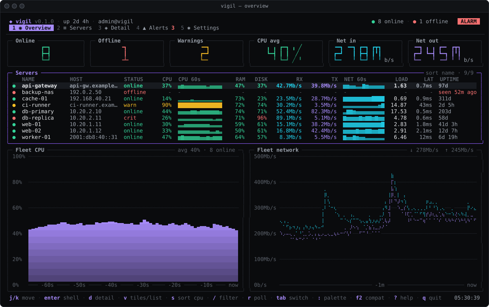
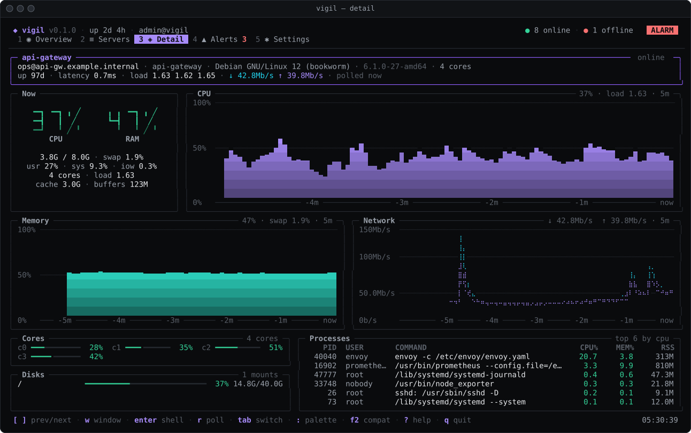
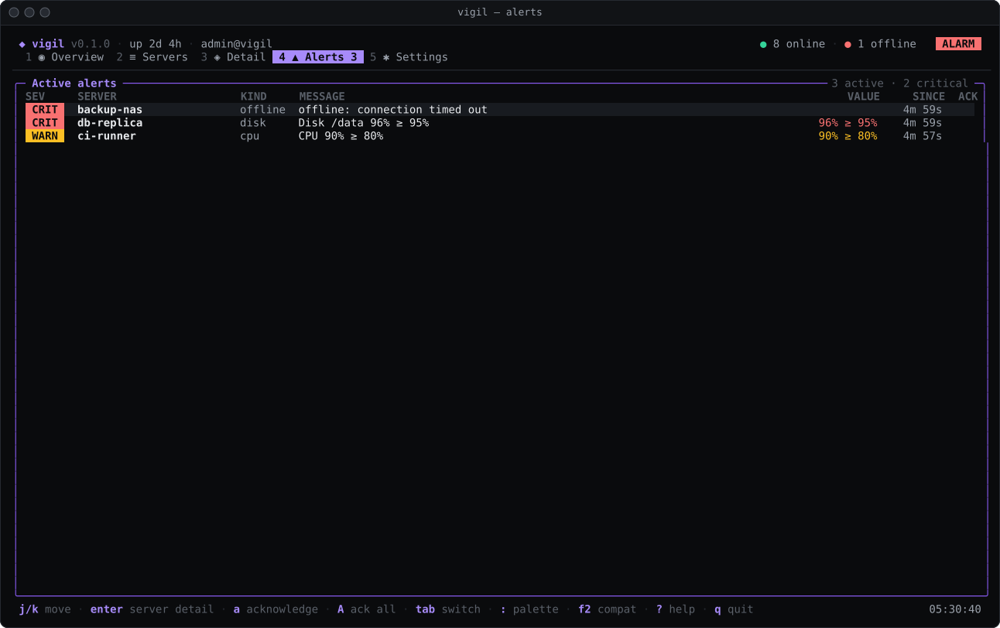
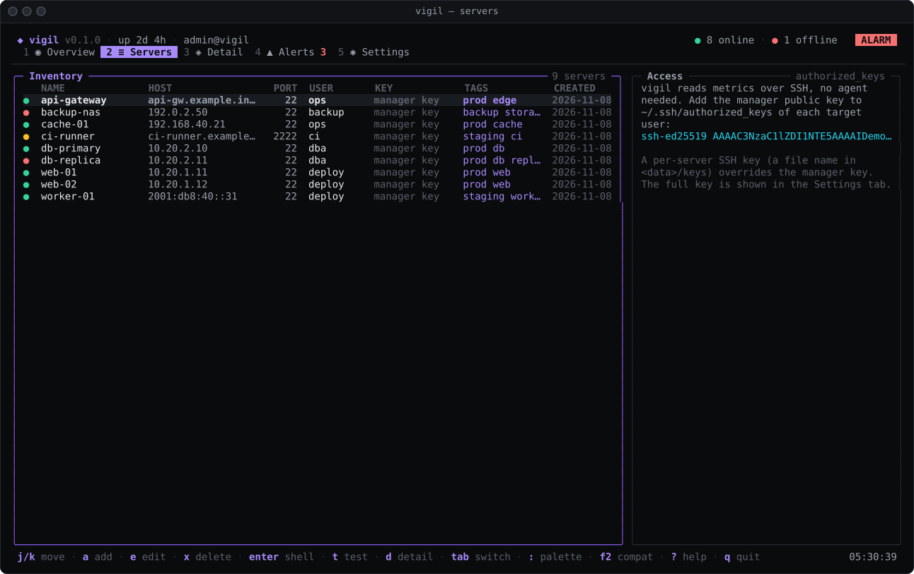
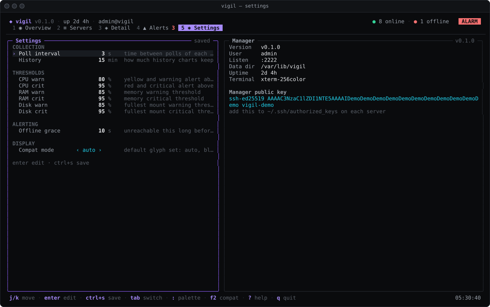

# vigil

**An SSH-served monitoring dashboard for your Linux fleet: no agents, no
web server, just `ssh` into a live terminal UI.**



vigil runs on one manager host. It polls every server over SSH, reading
`/proc` directly, and serves a [Bubble Tea](https://github.com/charmbracelet/bubbletea)
dashboard to anyone who connects with an SSH client:

```bash
ssh admin@manager -p 2222
```

## Features

- **Agentless metrics over SSH.** Nothing to install on the monitored
  servers besides the manager's public key. CPU, memory, swap, load,
  disks, network throughput, latency, uptime and top processes come from
  `/proc` and a few POSIX tools, in a single SSH exec per poll.
- **Live charts.** Per-server CPU and memory area charts, a braille
  network chart, per-core bars, disk usage and sparklines in the fleet
  table, refreshed every second.
- **Alerts with toasts.** CPU, memory, disk and offline alerts with
  warning/critical thresholds, hysteresis and acknowledgement; new alerts
  pop up as toasts in every open session.
- **Command palette.** `:` or `ctrl+k` opens a fuzzy palette with every
  tab, action and server.
- **One-key SSH shell.** Press `enter` on any server to drop into an
  interactive shell on it, and return to the dashboard when you exit.
- **Compat mode for limited fonts.** `f2` cycles between the full glyph
  set, block-only and pure ASCII rendering; the right mode is picked
  automatically for the Linux console, PuTTY, legacy Windows consoles
  and non-UTF-8 locales.
- **SSH app via Wish.** Every SSH session gets its own dashboard, with
  password and public key logins, per-IP rate limiting and an idle
  timeout.
- **Demo mode.** `vigil demo` shows a realistic synthetic fleet, no
  servers needed.

| Server detail | Alerts |
| --- | --- |
|  |  |
| **Servers** | **Settings** |
|  |  |

## Quick start

### Install

With Go 1.26 or newer:

```bash
go install github.com/Aepzie/vigil/cmd/vigil@latest
```

or build from source:

```bash
git clone https://github.com/Aepzie/vigil
cd vigil
make build        # or: go build ./cmd/vigil
```

### Try the demo

```bash
vigil demo
```

This runs the dashboard in your terminal with a synthetic fleet. To try
the SSH experience, serve the demo instead:

```bash
vigil demo --serve --public     # anyone may log in; synthetic data, no shells
ssh localhost -p 2222
```

Without `--public`, `vigil demo --serve` checks logins against the data
directory just like `vigil serve`.

### Run the manager

```bash
vigil serve                      # same as plain `vigil`; listens on :2222
```

On the first start, when no users or keys exist, vigil creates the
dashboard user `admin` with a random 20-character password and prints it
**once**, followed by the manager's public key:

```
+---------------------------------------------------+
| vigil first start: created dashboard user "admin" |
|                                                   |
|     password:  <20 random characters>             |
|                                                   |
| This password is shown only once. Log in with     |
|     ssh admin@<this-host> -p 2222                 |
| and change it with: vigil user passwd admin       |
+---------------------------------------------------+

Install the manager key on every monitored server (~/.ssh/authorized_keys):

ssh-ed25519 AAAAC3NzaC1lZDI1NTE5AAAA... vigil@manager
```

`vigil serve` flags:

| Flag | Default | Description |
| --- | --- | --- |
| `--listen ADDR` | `:2222` | SSH listen address |
| `--data DIR` | see [Configuration](#configuration) | data directory |
| `--idle-timeout D` | `30m` | disconnect sessions without input for this long (`0` disables) |
| `--max-sessions N` | `32` | maximum concurrent sessions (`0` = unlimited) |

### Authorize the manager on your servers

vigil logs in to every monitored server with its own key,
`<data>/id_ed25519`, generated on first start. Print the public half at
any time with

```bash
vigil pubkey
```

and append it to `~/.ssh/authorized_keys` of the remote user vigil should
use on each server, for example:

```bash
vigil pubkey | ssh ops@web-01 'mkdir -p ~/.ssh && cat >> ~/.ssh/authorized_keys'
```

The remote user needs no special privileges: everything vigil reads is normally
world-readable. Keep in mind that dashboard users can open shells on the
server **as this user**.

### Connect and add servers

```bash
ssh admin@manager -p 2222
```

Open the **Servers** tab (`2`), press `a` and fill in name, host, port,
user, an optional private key path (default: the manager key) and tags.
`t` tests the connection. The first connection to a server records its
host key (trust on first use).

The terminal needs to be at least 80×24 cells.

### Manage dashboard users

```bash
vigil user add alice            # prompts twice for the password, no echo
vigil user passwd alice
vigil user rm alice
vigil user list
echo 's3cret-pass' | vigil user add bob --password-stdin
```

User names are 1-32 characters from `a-z A-Z 0-9 _ . -`; passwords need 8
to 72 bytes. Changes apply to a running server immediately. For key-based
logins, add OpenSSH public keys to `<data>/authorized_keys`; a listed key
may log in under any user name.

### Run without SSH

`vigil local` runs the dashboard against the same data directory in your
current terminal, which is handy on a workstation.

## Key bindings

Global:

| Key | Action |
| --- | --- |
| `tab` / `shift+tab` | next / previous tab |
| `1`-`5` | jump to a tab (Overview, Servers, Detail, Alerts, Settings) |
| `:` / `ctrl+k` | command palette (`↑`/`↓` or `ctrl+p`/`ctrl+n` to move, `enter` to run, `ctrl+u` to clear, `esc` to close) |
| `f2` | cycle compatibility mode: auto, blocks, ascii, off |
| `?` | toggle help |
| `q` / `ctrl+c` | quit |

Overview:

| Key | Action |
| --- | --- |
| `j`/`k`, `↑`/`↓` | move (`h`/`j`/`k`/`l` in tile mode) |
| `g` / `G` | first / last server |
| `enter` | open a shell on the server |
| `d` | server detail |
| `v` | toggle tiles / list |
| `s` | cycle sort: name, CPU, memory, status |
| `/` | filter by name, host or tag (`enter` applies, `esc` clears) |
| `r` | poll the server now |

Servers:

| Key | Action |
| --- | --- |
| `j`/`k`, `↑`/`↓` | move |
| `a` / `e` / `x` | add / edit / delete a server (`y`/`n` to confirm deletion) |
| `enter` | open a shell on the server |
| `t` | test the connection |
| `d` | server detail |
| `tab` / `shift+tab`, `ctrl+s`, `esc` | in the form: next / previous field, save, cancel |

Detail:

| Key | Action |
| --- | --- |
| `[` / `]` | previous / next server |
| `enter` | open a shell on the server |
| `r` | poll the server now |

Alerts:

| Key | Action |
| --- | --- |
| `j`/`k`, `↑`/`↓` | move |
| `enter` | show the server's detail |
| `a` | acknowledge the selected alert |
| `A` | acknowledge all alerts |

Settings:

| Key | Action |
| --- | --- |
| `j`/`k`, `↑`/`↓` | move |
| `enter` | edit the value (`enter` confirms, `esc` cancels) |
| `←` / `→` | cycle the default compatibility mode |
| `ctrl+s` | save |
| `u` | revert unsaved changes |

## Configuration

All state lives in one data directory. vigil uses, in order, `--data`,
`$VIGIL_DATA`, `/var/lib/vigil` when running as root on Linux, and
otherwise the user config directory (for example `~/.config/vigil`). The
directory is created with mode `0700`.

| File | Contents |
| --- | --- |
| `servers.json` | monitored servers: name, host, port, user, optional `key_path`, tags |
| `settings.json` | manager settings (below) |
| `users.json` | dashboard users with bcrypt password hashes |
| `authorized_keys` | OpenSSH public keys allowed to log in to the dashboard |
| `host_ed25519` | the dashboard's SSH host key, generated on first start |
| `id_ed25519` (`.pub`) | the manager key used to log in to monitored servers |
| `known_hosts` | host keys of monitored servers, recorded on first connection |

JSON files are written atomically with mode `0600`. `users.json` and
`authorized_keys` are re-read when they change, `known_hosts` too, so you
can delete a stale line after reinstalling a server without restarting
vigil.

`settings.json` is edited from the Settings tab or by hand; missing fields
take their defaults:

```json
{
  "version": 1,
  "settings": {
    "poll_interval": "3s",
    "history_minutes": 15,
    "cpu_warn": 80,
    "cpu_crit": 95,
    "mem_warn": 85,
    "mem_crit": 95,
    "disk_warn": 85,
    "disk_crit": 95,
    "offline_grace": "10s",
    "compat": "auto"
  }
}
```

| Field | Range | Meaning |
| --- | --- | --- |
| `poll_interval` | 1s - 60s | time between polls of each server |
| `history_minutes` | 1 - 240 | how much history the charts keep |
| `cpu_warn`, `cpu_crit` | 1 - 100, warn < crit | CPU alert thresholds in percent |
| `mem_warn`, `mem_crit` | 1 - 100, warn < crit | memory alert thresholds in percent |
| `disk_warn`, `disk_crit` | 1 - 100, warn < crit | disk usage alert thresholds per mount, in percent |
| `offline_grace` | 0s - 10m | how long a server must be unreachable before an offline alert |
| `compat` | `auto`, `blocks`, `ascii`, `off` | default glyph compatibility mode |

CPU alerts need three consecutive samples above a threshold, memory and
disk alerts fire immediately, and every alert resolves only after the
value drops 5 points below its threshold.

## How metrics are collected

The manager keeps one persistent SSH connection per server and, once per
poll interval:

1. measures latency as the round trip of an SSH keepalive request, and
2. opens **one** session that runs `env LC_ALL=C LANG=C /bin/sh -s` and
   sends a small POSIX `sh` script on stdin, so the user's login shell
   does not matter.

The script prints `/proc/stat`, `/proc/meminfo`, `/proc/loadavg`,
`/proc/uptime`, `/proc/net/dev`, `df -kPT`, `uname -sr`, `os-release`,
the hostname, page size and clock tick rate, process owners, user names
from `/etc/passwd` and every `/proc/<pid>/stat`, separated by marker lines
that carry a random per-poll nonce so remote content cannot forge a
section. Output is capped at 4 MiB and each poll times out after twice
the interval (5s to 15s).

CPU, network and per-process figures are deltas between two polls.
Network rates cover all interfaces except loopback and container/VM
plumbing (veth, docker, bridges, CNI, ...). Unreachable servers are
reported offline every interval and redialed with jittered exponential
backoff (1s to 30s).

## Security model

vigil is a gateway to every monitored server, so treat dashboard accounts
like SSH access to those servers. In short:

- **Trust on first use.** The manager records each server's host key in
  `<data>/known_hosts` on the first connection and refuses a changed key
  afterwards. Verify the dashboard's own host key
  (`ssh-keygen -lf <data>/host_ed25519.pub`) the first time you connect.
- **Passwords** are stored as bcrypt hashes (cost 12); logins for unknown
  users take the same time as for known ones.
- **Key permissions.** Secret files are written with `0600` in a `0700`
  directory, and a too permissive host key is tightened to `0600` at
  startup.
- **Rate limiting.** Failed password attempts are delayed and limited
  per client IP (10 failures per 5 minutes block password logins from
  that IP), new sessions are rate limited per IP, and concurrent sessions
  are capped.
- **Sanitized output.** Everything read from monitored servers or SSH
  clients is stripped of control characters and escape sequences before
  it is rendered or logged.

Read [SECURITY.md](SECURITY.md) for the full threat model and how to
report a vulnerability.

## Deployment

### systemd

[`contrib/systemd/vigil.service`](contrib/systemd/vigil.service) runs vigil
as a dedicated `vigil` user with its state in `/var/lib/vigil` and
extensive systemd sandboxing:

```bash
sudo useradd --system --home-dir /var/lib/vigil --shell /usr/sbin/nologin vigil
sudo install -m 0755 vigil /usr/local/bin/vigil
sudo install -m 0644 contrib/systemd/vigil.service /etc/systemd/system/
sudo systemctl daemon-reload
sudo systemctl enable --now vigil
sudo journalctl -u vigil                                    # first-start admin password
sudo -u vigil VIGIL_DATA=/var/lib/vigil vigil pubkey        # manager key for your servers
sudo -u vigil VIGIL_DATA=/var/lib/vigil vigil user add alice
```

The first-start password ends up in the journal, so change it right away
(`vigil user passwd admin`) or create users before the first start.

### Docker

The [`Dockerfile`](Dockerfile) builds a static binary into a distroless
image that runs as an unprivileged user and keeps its state in the
`/data` volume:

```bash
docker build -t vigil --build-arg VERSION=$(git describe --tags --always) .
docker run -d --name vigil -p 2222:2222 -v vigil-data:/data vigil
docker logs vigil                          # first-start admin password
docker exec vigil vigil pubkey             # manager key for your servers
docker exec -i vigil vigil user add alice --password-stdin < password.txt
```

## Development

```bash
make test         # go test ./...
make lint         # go vet + gofmt check
make run-demo     # the dashboard with a synthetic fleet
make screenshots  # regenerate docs/screenshots/*.svg
```

Other targets: `build`, `install`, `race`, `cover`, `fmt`, `cross` and
`clean`; `make help` lists them. Without `make`, use `go test ./...`,
`go vet ./...`, `gofmt -l .` and `go run ./cmd/vigil demo`.

`vigil render` prints one frame of the demo fleet without a terminal,
which is how the screenshots above are made:

```bash
vigil render --tab detail --size 150x44 --format svg --out detail.svg
```

Branches are named `feature/…`, `fix/…` or `docs/…`, and commit messages
follow [Conventional Commits](https://www.conventionalcommits.org/)
(`feat(alerts): …`, `fix(server): …`). See
[CONTRIBUTING.md](CONTRIBUTING.md) for the full workflow and
[docs/ARCHITECTURE.md](docs/ARCHITECTURE.md) for a tour of the code.

## License

[MIT](LICENSE)
